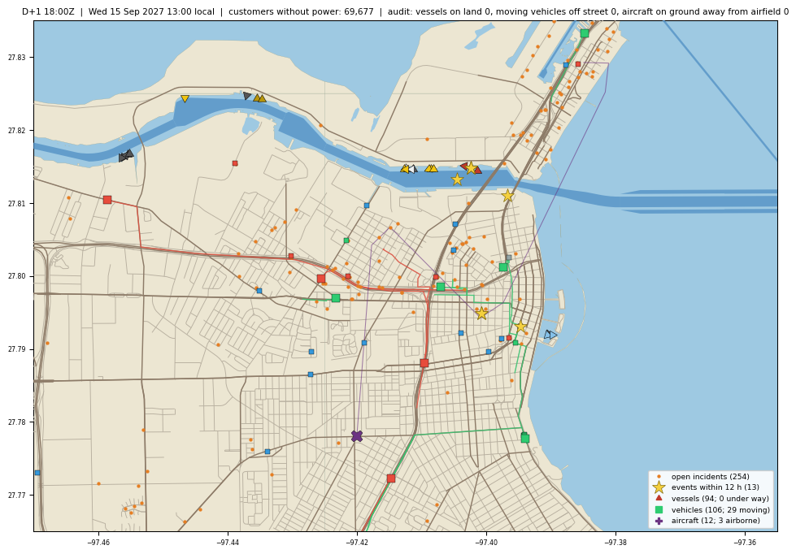
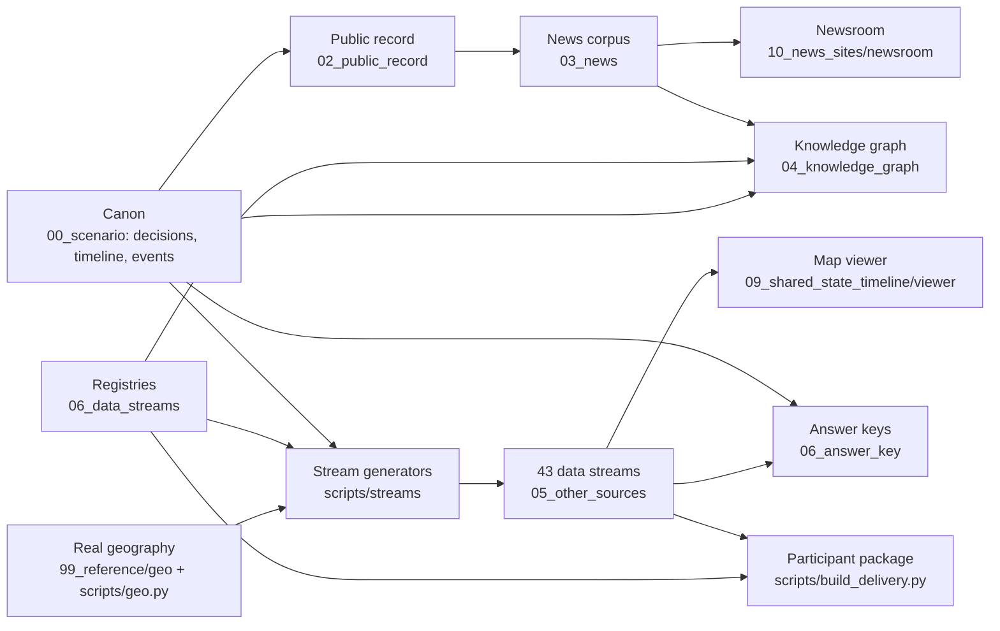
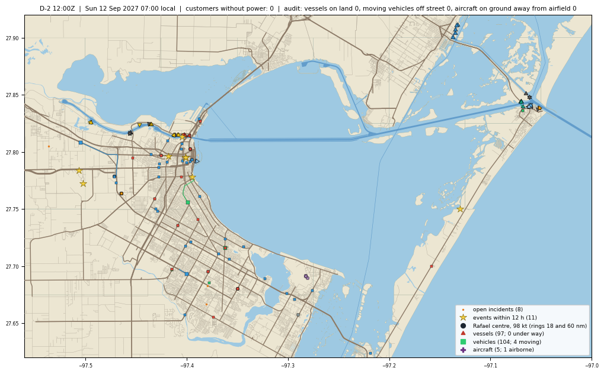

# Hurricane Rafael: a synthetic multi-source scenario

A fictional Category 3 hurricane strikes the real Texas Coastal Bend. Over six simulated months the storm, the response, and several hidden stories (a utility cyber intrusion, a tanker spill, a dark vessel, drones over an air station, devices in the ship channel, disaster-aid fraud, an influence operation) play out across **a news corpus, 43 linked data streams, registries, a knowledge graph and answer keys**. It is built as the foundation for a hackathon in which teams build AI tools that work out what happened from the data.

Everything is generated from one written timeline, placed on real geography, and checked by scripts in this repository.

> **This repository contains the answers.** The ground-truth event list, canon timeline, internal registry notes and answer keys are all here. Keep it private from participants and give them only the package built by `scripts/build_delivery.py` (see [Running an event](#running-an-event)).



*One day after landfall, drawn from the delivered logs over the real shoreline, ship channel and streets: every vessel is at a berth because the channel is closed, response vehicles follow streets, and incidents sit on real blocks.*

## What is in it

| | |
|---|---|
| Span | Scenario days -60 to +119. Landfall is day 0: 2027-09-14, 01:00 local (06:00 UTC), on Mustang Island near Port Aransas |
| News | 681 articles from 8 fictional outlets, each with a publish time; 177 dated public facts they may draw on |
| Ground truth | 182 events in 22 threads; 357 "expected observations" that say where each event shows up in the data |
| Data streams | 43 delivered streams, about 1.1 GB in 1,524 files (see below) |
| Entities | 130 vessels, 64 aircraft, 315 response units, 45 facilities, 329 utility hosts, 309 social accounts, 259 organisations, 148 areas, 84 sensors |
| Knowledge graph | 4,351 nodes and 26,940 links (internal view); 3,347 and 21,133 in the shareable public view |
| Answer keys | One per thread: 300 steps, each tied to records that exist on disk |
| Rule | Real places, fictional people. Agencies, bases, channels, streets and airfields are real; people, companies, outlets, hospitals, vessels and the storm are invented |

**The streams** imitate the systems a real response would leave behind:

- **Maritime:** AIS vessel positions, port radar and camera logs, port conditions, arrivals, cargo manifests
- **Air:** ADS-B aircraft positions, authorised drone telemetry, drone detections, satellite pass catalogue
- **Emergency response:** 911 dispatch records, vehicle locations, search-and-rescue missions, shelters, damage assessment, public alerts, broadcast logs, press releases
- **Utility and industrial:** SCADA historian, outage map, work orders, fuel deliveries, base status reports, tanker cargo-control logs
- **IT and security:** SIEM alerts, network sensor logs, host audit logs, aid-portal access logs
- **Environment and health:** weather stations and buoys, storm advisories, tide and stream gauges, water and air quality, wastewater sampling, emergency-department visits, hospital capacity, syndromic counts
- **Social and financial:** social media posts, insurance claims, aid applications, contracts, payments, census tables

`11_hackathon/DATA_GUIDE.md` describes every stream: format, time span, columns and how its ids join to the registries.

## Quick start

Requires Python 3.9 or newer. The newsroom needs nothing else; the generators and checks need three packages.

```bash
pip install -r requirements.txt        # numpy, matplotlib, opencv-python-headless
```

**Read the news as it breaks.** A small local server presents the eight outlets as websites and releases stories on a clock you control.

```bash
python 10_news_sites/newsroom/server.py           # this computer only
python 10_news_sites/newsroom/server.py --lan     # shared network; prints a game-master passphrase
```

Open the addresses it prints: `/` is the newsstand for participants, `/control` is the game-master clock, `/explorer` shows every article regardless of the clock, `/feeds` documents the RSS feeds and JSON API.

**Watch it on a map.** Open `09_shared_state_timeline/viewer/map_view.html` in a browser. It plays every logged vessel, aircraft and vehicle at 15-minute steps with the storm overlaid, and filters by what each audience could know. With an internet connection it uses Leaflet and satellite imagery; without one it falls back to a built-in chart.

**Explore the links.** Open `04_knowledge_graph/viewer.html`, or load `04_knowledge_graph/neo4j_import.cypher` into Neo4j.

**Confirm the data is sound.**

```bash
python scripts/check_acceptance.py                 # ten narrative criteria and the file lock
python scripts/check_entities.py                   # every id in every stream is in a registry
python scripts/check_canon_decisions.py --strict   # nothing contradicts the settled storyline
python scripts/check_geo.py --resume               # repeat until "COMPLETE - PASS" (4.8 million positions)
```

The full list of gates is in [Checks](#checks).

## How it is built



1. **Canon.** `00_scenario/canon_decisions.md` records how every conflict in the storyline was settled; `00_scenario/canon_timeline.json` is the machine-readable truth every generator reads.
2. **Public record and news.** Stories may only report public facts on or after the day they become public. `scripts/build_all.py` validates and links them and builds the release, RSS and graph.
3. **Registries.** Every vessel, aircraft, facility, unit, host, sensor, account and organisation is defined once in `06_data_streams/`, on a real site. Streams use only those ids.
4. **Geography.** `scripts/geo.py` answers questions against real geometry: is this point on land, which dredged channel is it in, what is the channel route between two berths, the street route between two addresses.
5. **Generators.** `scripts/streams/gen_*.py` write the streams. They are deterministic: the same inputs give the same bytes. Each family ships probes that find every expected observation in the files it wrote. The contract is `scripts/streams/README.md`.
6. **Map and package.** The map viewer's data is built from the logs, never the other way round. The participant package is built from the delivered files with everything internal stripped.

To change the data, change canon or a registry and re-run the affected generator. Nothing under `05_other_sources/` is edited by hand.

## Repository layout

| Path | Contents |
|---|---|
| `00_scenario/` | Ground truth: canon decisions and timeline, event list, threads, places |
| `01_characters/` | Characters with knowledge timelines, fixed facts, the eight outlets |
| `02_public_record/` | Dated public facts, restricted terms (what may be named from which day), number rules |
| `03_news/` | Story batches, storylines, index, RSS, writer guide and schema |
| `04_knowledge_graph/` | Internal and public graph (JSON, CSV, GraphML), Neo4j import, viewer |
| `05_other_sources/` | The 43 delivered data streams |
| `06_data_streams/` | Registries, stream catalogue, schemas; `_internal/` holds truth notes and is never delivered |
| `06_answer_key/` | Answer keys for the 22 threads |
| `07_validation/` | Acceptance criteria, latest check reports, three independent audits and their closure table, file lock |
| `08_release/` | Public fields of the news corpus |
| `09_shared_state_timeline/` | Hour-by-hour world state, storm track and advisories, timeline and map viewers |
| `10_news_sites/newsroom/` | The newsroom server, outlet templates, control page, explorer |
| `11_hackathon/` | Player brief, data guide, game-master guide, participant package manifest |
| `99_reference/geo/` | Real geometry with its sources and the rules each position must satisfy |
| `scenarios/` | Scenario registry and the utility-intrusion layer |
| `scripts/` | Pipeline, generators (`scripts/streams/`), checks, map and delivery builders |
| `docs/` | `PROJECT_GUIDE.md` (detailed working reference) and images |

## Geography

Positions are generated from, and checked against, published government data collected for this project (queries and dates are in `99_reference/geo/SOURCES_*.md`):

| Layer | Source |
|---|---|
| Ship channels, turning basins, Intracoastal Waterway (reaches and centerlines) | US Army Corps of Engineers, National Channel Framework |
| Land areas, anchorages, fairways | NOAA ENC Direct to GIS |
| Inland lakes, ponds, tidal channels | US Census TIGER areal hydrography, NOAA charted lakes, checked against USFWS wetlands data |
| Streets (12,786 roads, every local street in the area) | US Census TIGERweb |
| Landmarks: docks, runways, hospitals, stations, gauges, bridges (629 points) | USACE, FAA/NTAD, USGS, EPA, NOAA |

The rules, in `99_reference/geo/position_rules.json`: vessels are never on land, and deep-draft ships stay in channels dredged to 40 feet, in anchorages or in the open Gulf; consecutive fixes never have land between them; fixed assets are on land (or in water for sondes and buoys); incident locations are within 150 m of a street; moving vehicles are within 30 m of a road centreline; aircraft are on the ground only at airfields and helipads.



## Checks

Run from the repository root. Long checks work in pieces and resume, so repeat the commands marked "repeat" until they report completion.

| Command | What it proves |
|---|---|
| `python scripts/build_all.py` | Narrative pipeline: validation, story links, expected observations, answer keys, graph, RSS, release |
| `python scripts/check_acceptance.py` | Ten narrative criteria, public outputs free of never-public terms, files match the lock |
| `python scripts/check_streams.py --only=<stream,...>` | Each stream exists, covers its span, uses registry ids, has no answer-revealing columns, and contains its expected observations (357 in all; run a family at a time) |
| `python scripts/check_entities.py` | Every id in every stream exists in a registry |
| `python scripts/check_geo.py --resume` (repeat) | Every position satisfies its geographic rule |
| `python scripts/check_answer_keys.py --only=T1,T2,...` | Every answer-key step points at records on disk |
| `python scripts/check_thread_completeness.py` | Every thread has a beginning, escalation, discovery and resolution |
| `python scripts/check_canon_decisions.py --strict` | Stories, facts, registries and public-voice streams agree with the canon decisions |
| `python scripts/check_catalog.py` | The stream catalogue and schemas describe the files on disk |
| `python scripts/build_map.py --resume` (repeat), then `python scripts/check_map.py --all --resume` (repeat) | Map data is current; on every day no vessel is on land and no moving vehicle is off a road |
| `python 10_news_sites/newsroom/tools/verify_gating.py` | No story is reachable through the newsroom before its publish time |
| `python scripts/build_delivery.py` | The participant package contains nothing internal |

Results at the last full run (2026-11-11): 0 geographic violations in 4,792,551 positions; 357 of 357 expected observations present; 300 of 300 answer-key steps verified; acceptance PASS. Reports are in `07_validation/reports/`.

After a reviewed change, `python scripts/snapshot.py --lock` records new file hashes; until then `check_acceptance.py` fails its lock criterion by design.

## Regenerating the streams

Generators are listed with their order and options in `docs/PROJECT_GUIDE.md` and `scripts/streams/README.md`. In short: maritime first, then ground (it writes the rescue sortie plan), aviation, drones, satellite, utility, IT security, environment, health, finance, census, and social media last because its automated accounts read other streams. Afterwards run the checks above and rebuild the map.

## Running an event

1. Build the participant package: `python scripts/build_delivery.py --copy <folder>` (add `--until YYYY-MM-DD` for a staged release). It writes `11_hackathon/delivery_manifest.json`, scans for internal ids and never-public terms, and fails if anything internal would ship.
2. Give participants that folder, `11_hackathon/PLAYER_BRIEF.md` and `11_hackathon/DATA_GUIDE.md`.
3. Start the newsroom with `--lan` and advance the clock from `/control`; team tools can poll the RSS feeds and API, which never show a story early.
4. Score with `06_answer_key/answer_key.json`. `11_hackathon/GAME_MASTER_GUIDE.md` has the details.

## Publishing a clean copy

The working folder also holds local history archives, caches and run state. `scripts/package_repo.py` copies only the current, working parts to a folder outside the project, rewrites machine-specific paths in the few helper scripts that recorded them, and scans the result for local paths, e-mail addresses and the newsroom's signing secret.

```bash
python scripts/package_repo.py ../hurricane-rafael-scenario          # repeat until COMPLETE
python scripts/package_repo.py ../hurricane-rafael-scenario --scan   # must print SCAN PASS
cd ../hurricane-rafael-scenario
python scripts/snapshot.py --lock && python scripts/check_acceptance.py
```

The copy is about 1.2 GB in 2,600 files, with no file over 45 MB, so it fits an ordinary git repository without large-file storage. `.gitattributes` turns off line-ending conversion because the lock records exact file hashes.

## Known limits

- The map's satellite view and the live newsroom pages have had little hands-on browser testing; the map has been seen rendered only in its offline fallback view.
- Three independent audits found 96 defects; `07_validation/reports/audit_closure.md` records 92 closed and 4 minor ones partly closed. The fixes were verified by scripts, not by a further independent audit.
- At the edges of the reference map, about 12 km of road near Copano Bay reads as water, and about 180 remote ponds were not cross-checked.
- Network addresses and host names in the logs are invented but written in routable ranges and ordinary top-level domains so that hostile traffic does not stand out; they do not refer to real hosts.
- Some real-world details written into stories (evacuation registries, causeways, references to earlier hurricanes) should be reviewed before any public release.

## Data notes and licence

All people, companies, vessels, aircraft, outlets, hospitals and events are fictional; any resemblance to real ones is unintended. Real place names and public infrastructure are used for realism. `99_reference/geo/landmarks.geojson` carries real facility names from the public sources listed above and is reference data only.

No licence has been chosen for this repository yet. Add one before sharing it outside your organisation. The geographic reference files derive from US Government sources; check each source's terms in `99_reference/geo/SOURCES_*.md`.

## More documentation

- `docs/PROJECT_GUIDE.md`: the detailed working reference (generators, pipeline steps, quality gates, how to add news)
- `00_scenario/canon_decisions.md`: every storyline decision and why
- `scripts/streams/README.md`: the generator contract
- `07_validation/ACCEPTANCE.md`: the acceptance gates
- `10_news_sites/newsroom/README.md`: game-master guide to the newsroom
- `CHANGELOG.md`: what changed and when
